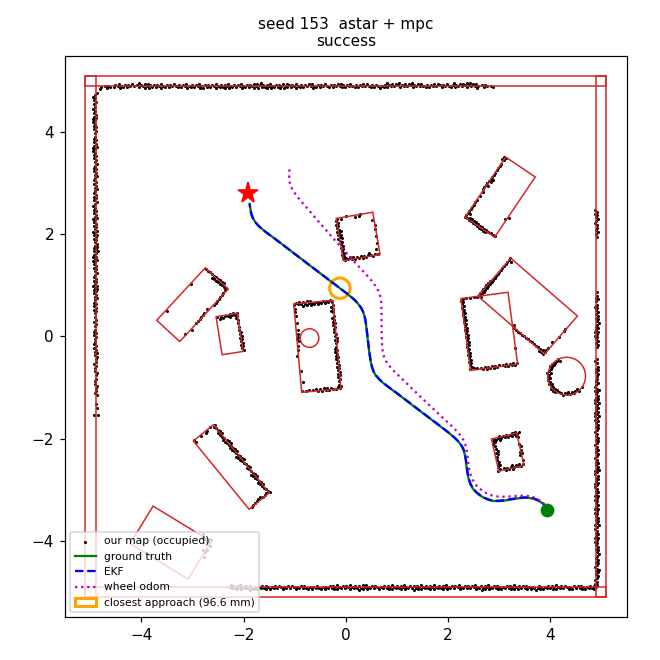

# ROS 2 Navigation Stack from Scratch

Autonomous navigation for a simulated differential drive robot, built without Nav2. The robot starts in an unknown environment with a lidar, an IMU and wheel encoders, builds a map as it drives, and plans and follows a path to the goal. Localization, mapping, planning and control are all implemented from nada in C++.

**A\* + MPC reaches the goal in 98.0% of 200 random worlds (95% CI 95.0 to 99.2%)**, scored against Gazebo ground truth.



## Overview

| component | implementation | source |
|---|---|---|
| State estimation | EKF fusing wheel odometry and IMU gyro, with online gyro bias estimation | `src/nav_stack/src/ekf.cpp` |
| Mapping | Log-odds occupancy grid | `src/nav_stack/src/grid.cpp` |
| Planning | A\* and RRT\* on an inflated costmap, with path shortcutting and resampling | `src/nav_stack/src/astar.cpp`, `src/nav_stack/src/rrt_star.cpp` |
| Control | Pure pursuit and model predictive control (MPC) | `src/nav_stack/src/pure_pursuit.cpp`, `src/nav_stack/src/mpc.cpp` |
| Evaluation | Random world generator, trial runner, parallel batch runner, ground truth scoring | `eval/` |

The algorithms live in a standalone C++ library with no ROS dependency and are covered by gtest unit tests. The ROS 2 nodes are thin wrappers around the library.

Third-party components: Gazebo, the ROS/Gazebo bridge, and slam_toolbox (used only as a mapping baseline). Ground truth poses are used for scoring only and are never visible to the stack.

## Results

All numbers are generated by `eval/summarize.py` and stored in `results/summary.md`. Each trial runs in a new random 10 x 10 m world with 12 obstacles (20 in the hard set). The robot has no prior map.

The success criteria were fixed before the evaluation was run (no moving the goalposts afterwards). A trial succeeds only if:

- the controller reports the goal as reached,
- the ground truth position is within 0.5 m of the goal (0.2 m goal tolerance plus margin for localization drift),
- the bumper never triggers, and
- no part of the robot's outline (body, wheels, casters) comes within 5 mm of an obstacle. This is checked from ground truth, since the bumper only covers the body.

### Navigation

| worlds | planner + controller | success | 95% CI | median time to goal | median clearance | tracking error (RMS) |
|---|---|---|---|---|---|---|
| main (200) | **A\* + MPC** | **98.0%** | 95.0 to 99.2% | 16.8 s | 0.341 m | 0.021 m |
| main (200) | A\* + pure pursuit | 92.0% | 87.4 to 95.0% | 26.2 s | 0.331 m | 0.056 m |
| main (200) | RRT\* + MPC | 84.0% | 78.3 to 88.4% | 16.8 s | 0.094 m | 0.067 m |
| main (200) | RRT\* + pure pursuit | 88.5% | 83.3 to 92.2% | 21.9 s | 0.106 m | 0.070 m |
| hard, 20 obstacles (100) | A\* + MPC | 96.0% | 90.2 to 98.4% | 17.0 s | 0.260 m | 0.022 m |
| hard, 20 obstacles (100) | A\* + pure pursuit | 94.0% | 87.5 to 97.2% | 28.2 s | 0.262 m | 0.056 m |

Median time to goal is over successful trials. Clearance is the closest any part of the robot came to an obstacle during the run.

Failure breakdown (each failure counted once, under the first reason that applies):

| worlds | planner + controller | bumper | touched (< 5 mm) | timeout | never moved | ended > 0.5 m off |
|---|---|---|---|---|---|---|
| main | A\* + MPC | 2 | 0 | 0 | 0 | 2 |
| main | A\* + pure pursuit | 0 | 0 | 4 | 0 | 12 |
| main | RRT\* + MPC | 26 | 5 | 1 | 0 | 0 |
| main | RRT\* + pure pursuit | 14 | 8 | 1 | 0 | 0 |
| hard | A\* + MPC | 3 | 0 | 0 | 1 | 0 |
| hard | A\* + pure pursuit | 1 | 0 | 0 | 0 | 5 |

Key findings:

- **RRT\* failures are almost entirely grazes.** Most overlap an obstacle by about 1 mm. Shortcut RRT\* paths run along the edge of the inflated obstacles, while A\* paths keep a margin: median clearance is 0.09 to 0.11 m with RRT\* versus 0.33 to 0.34 m with A\* (see `results/figures/clearance.png`).
- **MPC does worse than pure pursuit on RRT\* paths** (84.0% vs 88.5%). Tighter tracking of a path that hugs an obstacle means more contact. On A\* paths, the same tracking accuracy makes MPC the best controller.
- **Pure pursuit failures are mostly localization drift.** Slower runs give the EKF more time to drift; most of these failures end 0.52 to 0.62 m from the goal, just past the threshold.
- **The A\* + MPC bumper contact in seed 74 happened on a hairpin turn** around the corner of an already mapped box. MPC cuts slightly inside very tight turns, and the inside wheel clipped the corner by 0.8 mm.
- **Some worlds are hard for every configuration.** Seed 79 defeats both A\* configurations and seed 28 defeats three of four, each due to one narrow passage.

### State estimation (EKF vs wheel odometry)

| | final position error (median) | 90th percentile | trajectory RMSE (median) | final heading error (median) |
|---|---|---|---|---|
| wheel odometry | 0.683 m | 1.466 m | 0.308 m | 11.0° |
| EKF (wheels + IMU) | **0.035 m** | 0.262 m | 0.019 m | 0.4° |

Across 997 closed-loop trials, the EKF finished closer to the true position than wheel odometry in 96.0% of them. Most of the improvement is in heading: wheel slip during turns and a 1% wheel radius error accumulate quickly, while the bias-corrected gyro barely drifts.

### Controller comparison on identical worlds

Both controllers ran on the same 200 worlds, so the comparison is per world rather than on averages.

| planner | worlds | pure pursuit (tracking RMS) | MPC (tracking RMS) | MPC lower in |
|---|---|---|---|---|
| A\* | 200 | 0.056 m | 0.021 m | 100% of worlds |
| RRT\* | 200 | 0.070 m | 0.067 m | 71% of worlds |

On A\* paths MPC tracks more closely in every single world, at less than half the error. On RRT\* paths the gap almost disappears, since sharp shortcut corners are hard for either controller to follow exactly.

### Planner benchmark (offline, on the true maps of the 200 main worlds)

| planner | runs | success | median time | mean length | length vs A\* (median) |
|---|---|---|---|---|---|
| A\* | 200 | 100% | 0.45 ms | 7.91 m | 1.000 |
| RRT, first solution (+ shortcut) | 1000 | 100% | 0.23 ms | 7.68 m | 0.947 |
| RRT\*, 3000 iterations (+ shortcut) | 1000 | 100% | 91.31 ms | 7.32 m | 0.929 |

RRT runs 5 times per map, since it is randomized. After shortcutting, both RRT variants produce shorter paths than A\*, which is limited to 8 grid directions while shortcut segments can take any angle. The 3000 RRT\* iterations make paths a further 2 to 5% shorter than the first RRT solution (median ratio and mean length respectively), at roughly 400 times the runtime.

### Mapping vs slam_toolbox (20 runs, to the goal and back)

| mapper | precision (occupied cells within 10 cm of a real obstacle) | coverage (obstacle edges found) |
|---|---|---|
| this stack | 94.8% | 55.1% |
| slam_toolbox | 99.9% | 55.4% |

Coverage is limited by what the robot sees along its route, so it is nearly identical for both. The precision gap comes from long-range lidar returns (up to 8 m): a small heading error displaces distant walls far more than nearby ones. slam_toolbox corrects its pose with scan matching, while this mapper relies on the EKF pose alone.

## Development notes

Problems found during development, and how they were resolved:

- **Bumper sensor silently broken.** The contact sensor's `<topic>` tag was outside its `<contact>` block in the SDF, so Gazebo ignored it and every collision count read 0 (a very reassuring number, unfortunately wrong). Fixed in one line. `eval/crash_test.py` now drives into a wall on purpose to verify the sensor, which also revealed that the bumper covers only the body. That led to the geometric clearance check.
- **MPC stalling on RRT\* paths.** RRT\* waypoints are about 0.3 m apart, and the MPC reference started at the nearest waypoint, which could be behind the robot. The robot would stop at x = 0.19 m. Resampling all paths to 5 cm spacing took RRT\* + MPC from 9/15 to 15/15 on the test worlds and cut the median time to goal from 130 s to 19.4 s.
- **Cross-talk between parallel trials.** Without isolation, simultaneous trials received each other's commands; one logged 19.5 km of driving in a 10 m world. Assigning each slot its own `ROS_DOMAIN_ID` and `GZ_PARTITION` fixed it (same trial: 18.8 s).
- **Cleanup script killing the compiler.** `pkill -f _node` also matched the compiler building `planner_node.cpp`. The pattern now matches `lib/nav_stack/` only.
- **A clearance fix that made things worse.** Requiring RRT\* shortcuts to keep 0.35 m from obstacles dropped success to 26/30, because rejected shortcuts fell back to raw tree edges that were even closer to obstacles. Reverted; documented under limitations.

## Limitations

- Simulation only: one robot model, one environment type (boxes and cylinders in a walled square), no moving obstacles.
- Inflation does not account for the robot's swept area while turning, so hairpin turns around corners can graze them.
- RRT\* paths pass very close to obstacles. A proper fix would smooth paths against a distance field rather than only shortcutting.
- No scan matching or loop closure in the mapper; it relies entirely on the EKF pose.
- The RRT\* time budget is wall-clock time, so results vary with CPU load (for example, when running trials in parallel).
- Wheel calibration error and IMU noise are chosen values, not measured from a real robot.

## Quick start

Requires Docker. Everything runs in `osrf/ros:jazzy-desktop-full` (ROS 2 Jazzy, Gazebo Harmonic).

```bash
docker build -t ros2-nav docker/
./docker/run.sh                 # shell in the container, repo at /ws

# inside the container
colcon build
source install/setup.bash
colcon test --packages-select nav_stack && colcon test-result --verbose

# one scored trial (about 15 s)
python3 eval/run_trial.py --seed 7
python3 eval/plot_trial.py results/trials/0007_astar_mpc seed7.png

# full evaluation (about 1,000 trials, several hours with 3 jobs), then tables and figures
nohup bash eval/run_all.sh > run_all.log 2>&1 &
python3 eval/summarize.py results
```

## Repository layout

```
src/nav_stack/   C++ library, ROS nodes, gtest tests, planner benchmark
src/nav_sim/     robot model, world generator, bridge config, sim launch file
eval/            trial runner, batch runner, scoring, map comparison, plots
results/         summary.md, summary.json, figures/ (raw trial data not committed)
docker/          Dockerfile and run script
```
